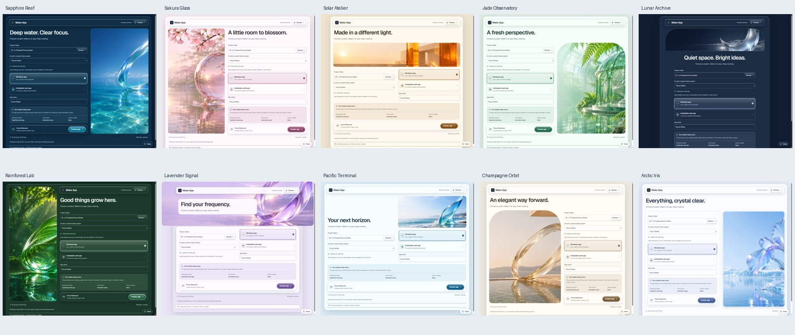
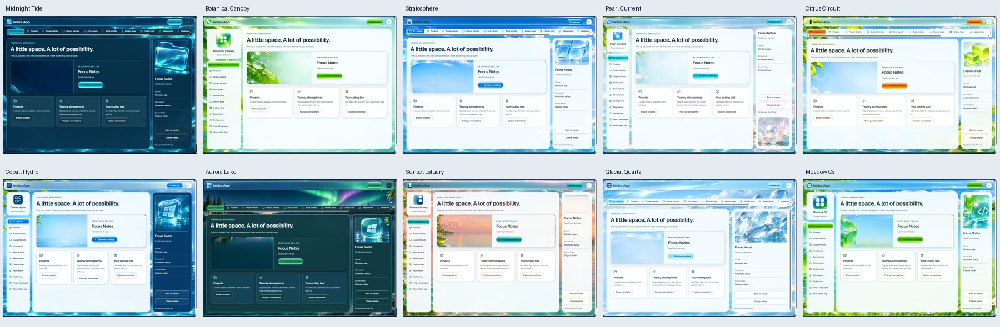
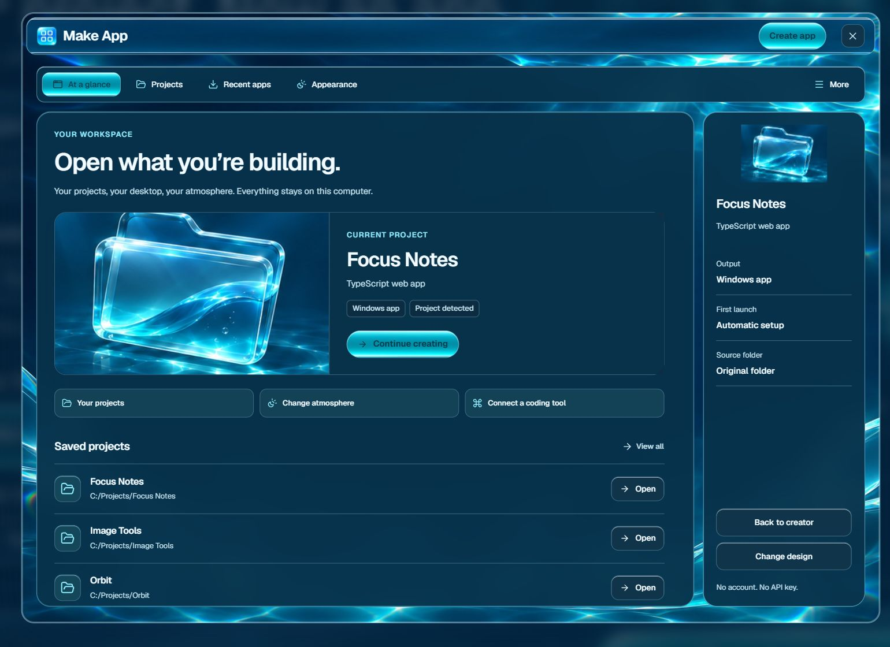

# Make App

Turn a local project into an app you can double-click. Make App detects its setup and runs it on your computer. No website or hosted workspace is required.

**Free · MIT licensed · Local execution · No account or API key**

[Downloads](https://github.com/moonshineaitech/make-app/releases) · [Codex plugin](docs/CODEX.md) · [Other coding tools](docs/HARNESSES.md) · [Device support](docs/CROSS_PLATFORM.md) · [Validation](docs/VALIDATION.md)


The creator includes twenty selectable Frutiger Aero themes and a Classic appearance. The complete product website includes the same interactive renderer. [Preview, build and verify the website](docs/INTERFACE.md) with `npm run preview:site`.

## Start here

1. Download the converter for your computer from **Releases**.
2. Open it and choose a folder, or pick a saved Codex project.
3. Click **Create app**. A fresh executable is saved on your Desktop automatically.
4. Click **Open app**. Next time, double-click the Desktop file.

Make App remembers your last project and recently chosen folders. Setup is detected automatically; choose an entry point only when a project has several. Existing Desktop files are preserved. The persistent bottom toolbar provides **Designs**, **Projects**, **Export** and **Views** in every design, including the original ten.

Open **Export** (or press **Alt+E**) to choose desktop or static web output, see Windows/macOS/Linux and CPU options, and choose a save location. Desktop creation runs on the matching OS and CPU; another target shows the matching download and explains which computer is needed. **Use this computer** restores the correct target. Unsupported standalone runtimes are explained before creation begins.

**Views → Recent apps** remembers up to twenty completed exports locally. Open an available desktop app, show its file, copy its path, or create it again from the source. After moving or renaming an export, use **Find moved app** and choose the finished file or complete `.app` bundle. Make App compares its embedded export settings with the saved entry, reconnects that location and updates the current app’s Open action. Cancelling or choosing another export preserves the entry. Available older entries acquire this identity automatically; an older entry already missing without an identity needs a fresh export. Clearing the list preserves your exported files. The success screen also offers **Create another app**.

**Create stays clickable while a project needs attention.** It opens readable guidance with an action to choose a folder, select an entry point, switch output format, or restore this computer’s OS/CPU. Copy details includes the version, project path and reason for troubleshooting. The button locks while an app operation is in progress.

Use **Projects → Choose file** to select a game’s HTML file, exported EXE or supported script directly. Use a dedicated project folder: neighbouring files are bundled too. Cancelling the picker preserves the current project and result. A folder without recognized entries offers this picker instead of an empty selector. Failed creation shows the exact error, expandable build details and **Try again**. An unavailable saved app offers **Create a fresh app**. Cancelling creation returns to the creator without a failure dialog.

For browser games, choose the project folder: a single named HTML file such as `my-game.html` is detected automatically, and several HTML files offer a chooser. On Windows, a folder containing an exported game EXE is recognized with its neighbouring assets, DLLs, PCK or Unity data folder. Matching game data helps distinguish the main game from helper executables. Godot/Unity **editor source** still needs an engine export first; choose that completed desktop build folder. Make App does not yet build those editor projects into standalone games automatically.

Desktop outputs now include a compressed project snapshot, installed dependencies and the required managed runtime or compiled artifact. **Move or share the finished executable; the original project folder and converter are not required.** First launch extracts a private writable copy into app storage. Windows uses one `.exe`, Linux one `.run`, and macOS an `.app` bundle (zip it to share). Build for the recipient OS and architecture.

First launch shows verification and extraction progress with file and byte counts. Later launches reuse the prepared copy. Cancelling or encountering a disk error removes the incomplete extraction after its pending writes close.

Before sharing a new export, use **Export → Check launch** or **Recent apps → Check launch**. Make App opens a temporary receiving profile, checks the initial app page, native process or command, stops it and removes that copy. The saved EXE stays in place. Results and their time are kept locally in Recent apps. The check can be cancelled and has a bounded timeout. It checks startup, not full functionality, account access or gameplay. Older exports must be recreated with Make App 0.20 or newer to support this optional check.

Recent apps recommends another startup check when a saved file’s size or modification time changes, or after reconnecting a moved app. This metadata hint and embedded-settings match do not attest to all files inside an app or replace publisher signing. Check launch verifies the bundled payload during its normal opening flow.

Directly selected Python files now use the same bundled-interpreter adapter as Python projects. Recognized GUI/game imports select the native window mode; console scripts retain their command interface.

Before sharing a new desktop export, use **Export → Check launch** or **Recent apps → Check launch**. Click **Start check** to run it in a temporary receiving profile, check initial startup, stop the app and remove that temporary copy. The result explains a failure or timeout and can be copied; Recent apps remembers the last check locally. Cancellation stops the checking process. Older exports need to be recreated with Make App 0.20 or newer to support this action.

This checks startup rather than full functionality or gameplay. A native process must stay running through the startup check; a web/HTML app must load its desktop page. Applications run normally and can contact their own services. Accounts, credentials, OS libraries and hardware remain application requirements.

Known generated output folders that your project ignores are omitted, so old installers and development scratch tools do not bloat the new app. Explicit runtime paths and production build assets are preserved. Windows single-file output has a supported limit of 2 GB; larger results are refused before replacing an existing app.

Packaging may run dependency installation and build steps in a temporary snapshot. It preserves the original project and excludes dot-env files, private key files and common caches. External APIs, accounts, databases, hardware and OS libraries remain application requirements; secrets are not automatically embedded. Unsupported self-contained runtime combinations fail with a specific packaging message.

A web export copies an existing static build into a new folder. Upload that folder to any static HTTPS host, then open its URL on your devices. Supported browsers offer **Install App** or **Add to Home Screen**. Offline access starts after the first successful visit and service-worker installation. Backend services, external APIs and authentication still need their own connectivity and hosting.

## Make it yours

Click the **Make App** wordmark (or press **Alt+T**) in a photographic theme to switch between twenty Frutiger Aero designs, from midnight water and aurora glass to botanical green, pearl and sunlit skies. Themes are included offline and your choice is remembered. Classic also offers system, light and dark appearance. Changing a theme preserves your selected project and creation progress. [Interface and accessibility details](docs/INTERFACE.md).


The **Views** button (or **Alt+G**) opens twelve focused screens: overview, projects, project details, output formats, first launch, build activity, recent apps, coding tools, appearance, preferences, help and about. Project search and pins, live build messages, recent output paths, theme search, spacing and reduced motion are included. These screens use the same local creator and its real state.

The second collection adds Sapphire Reef, Sakura Glass, Solar Atelier, Jade Observatory, Lunar Archive, Rainforest Lab, Lavender Signal, Pacific Terminal, Champagne Orbit and Arctic Iris. Each has original bundled scenery and a distinct responsive composition.



## Glass motion

Both collections, the website and launch screens share seven kinds of motion: specular shine, staggered entrances, spring press feedback, water ripples and focus glints, image depth, panel lighting, and selection/progress/success feedback. Text remains fully opaque while moving. Original photographic positions and scale transforms stay under the original renderer.

Open **Views → Preferences → Motion** for Glass motion, Subtle motion or Reduced motion. System reduced motion always takes precedence. Decorative work pauses when the app is hidden; hover effects adapt for touch.

## The original collection, completed

The original ten designs remain intact: Midnight Tide, Botanical Canopy, Stratosphere, Pearl Current, Citrus Circuit, Cobalt Hydro, Aurora Lake, Sunset Estuary, Glacial Quartz and Meadow OS. Each now includes the original creator **plus twelve matching app screens**, using its own glass materials, imagery, navigation and project receipt. Choose **Original designs** in the app to open this collection. The newer Studio collection remains available beside it.



The original creator artwork and measured controls are preserved. The surrounding screens share real project and creation state; they are functional interfaces rather than screenshots.

## A clearer workspace

The 0.14 workspace puts saved projects directly on the overview, with the current project's original glass illustration, output and detection status. Horizontal layouts use four primary destinations and a keyboard-accessible **More** menu for the remaining views. The original sidebar compositions remain available.

Appearance now has larger previews, search, Original/Studio collection filters and a visible current-design marker. Applying a design keeps the library, search and project in place. Refined typography, quieter glass borders, themed scrollbars and a responsive compact navigation carry through all twenty designs. The measured photographic creator screens remain intact.



The complete website uses matching Aero photography and glass materials. Its searchable gallery lets you try every design directly in the interactive preview, with Original/Studio filters and a clearly marked sample-project environment. Run `npm run preview:site` locally or build the static files with `npm run build:site`.

Native release acceptance now includes a fresh runtime cache on every desktop target. Each platform manifest records the converter/CLI checks and the verified runtime download, project launch and shutdown. Windows uses its native ZIP extractor when available to reduce first-launch extraction time. Draft creation requires passing source/interface verification for the same commit.

## Choose your download

**Release status:** binary assets remain private while a release is a draft. The source and CI results are public. Desktop builds use native acceptance on each target; check the validation page and release assets before choosing a build. [Hosting and storefront distribution](docs/DISTRIBUTION.md) covers direct downloads, itch.io, Whop and store requirements.

| Computer | Converter asset | Codex plugin asset |
| --- | --- | --- |
| Windows x64 | `Make-App-Windows-x64.exe` | `Make-App-Codex-Plugin-Windows-x64.zip` |
| macOS, Apple Silicon | `Make-App-macOS-arm64.zip` | `Make-App-Codex-Plugin-macOS-arm64.tar.gz` |
| macOS, Intel | `Make-App-macOS-x64.zip` | `Make-App-Codex-Plugin-macOS-x64.tar.gz` |
| Linux x64 | `Make-App-Linux-x64.AppImage` | `Make-App-Codex-Plugin-Linux-x64.tar.gz` |
| Linux ARM64 | `Make-App-Linux-arm64.AppImage` | `Make-App-Codex-Plugin-Linux-arm64.tar.gz` |

Use the assets on the [release page](https://github.com/moonshineaitech/make-app/releases). GitHub's **Code → Download ZIP** contains development source, without the converter or complete plugin dependencies. Each platform bundle includes its own checksum list, release manifest and runtime dependency SBOM. Signing and notarization remain release gates; this is an unsigned preview.

On macOS, extract the ZIP and open **Make App.app**. On Linux, allow the AppImage to run as a program, then open it. The generated Linux `.run` file is executable and includes its desktop runtime; its launcher supports extraction without requiring FUSE. Windows uses an `.exe`. Build apps on their target desktop OS; Make App does not cross-compile arbitrary projects.

## Use it from Codex

Download the plugin archive matching your OS and architecture. Extract the entire archive to a folder you will keep, then run its **Install Codex Plugin** script. Codex must already be installed. The archive includes Node and the converter, so there is no global Node installation, API key, administrator step or manual MCP configuration.

Open a new Codex chat and ask:

> Make a desktop app for this project.

For a static web build:

> Export this project as an installable web app.

The plugin includes the `run-project` skill and four tools: `inspect_project`, `list_projects`, `make_executable` and `open_project`. The creation tool needs only your project path; it chooses a fresh output name automatically. It accepts desktop or web output. [Installation, updates and removal](docs/CODEX.md).

## Use it from another coding tool

In a complete 0.8.1+ plugin archive, open **Connect Coding Tool**, select your harness and choose your project folder. Supported project adapters cover Codex, Claude Code, Cursor, current VS Code/Copilot, older VS Code Local, Gemini CLI and OpenCode. Setup preserves unrelated configuration and comments. Codex is not required for these routes.

Other local harnesses can use the generic MCP configuration or the bundled `make-app` command, which returns JSON. The same engine powers the plugin, MCP server and CLI. A hosted-only chat needs a local agent or worker with access to the project; it cannot reach your computer automatically. [Setup, commands, compatibility and removal](docs/HARNESSES.md).

## Device support

| Device | What it can use |
| --- | --- |
| Windows, macOS and Linux computers | Native converter, Codex plugin and generated apps for their OS |
| iPhone and iPad | Hosted web exports in Safari and compatible browsers; home-screen installation where supported |
| Android phones and tablets | Hosted web exports; browser installation where supported |
| Chromebooks | Hosted web exports; Linux desktop support depends on the device's Linux environment |
| Other modern browser devices | Hosted web exports, subject to browser capabilities |

The converter runs on desktop operating systems. A phone browser cannot run an arbitrary desktop executable, compiler, native game or backend service. Web export is available when an existing static build is detected in the chosen folder or its `dist`, `build`, `out` or `public` directory. Native platform SDKs, GPUs, hardware access and external services remain project requirements. [Support boundaries and formats](docs/CROSS_PLATFORM.md).

## Languages and setup

| Stack | Recognized workflows | Setup behavior |
| --- | --- | --- |
| Rust | Cargo binaries, workspaces and standalone programs | Uses installed Rust or a private verified toolchain; native libraries and platform SDKs may be required |
| TypeScript / JavaScript | Package scripts, CLI entry points, local services and common frontend layouts | Compatible installed or private Node runtime, lockfile-aware npm/pnpm/Yarn setup and pinned TypeScript runner |
| Python | Common scripts, web, console and desktop entry points | Uses available Python 3 or provisions private CPython when missing; unusual version constraints need a compatible interpreter |
| Go | Modules and executable targets, including services | Uses installed or private Go SDK |
| C# / .NET | Console, ASP.NET and recognized GUI projects | SDK selection and private preparation; Windows-specific frameworks require Windows |
| Java | Source entries and recognized layouts | Uses installed or private JDK; Maven/Gradle and framework coverage varies |
| C / C++ | Single-file programs and CMake executable targets | Private Zig compiler and recognized CMake/Ninja workflows; project-specific native libraries may still need setup |
| Ruby | Script entries and Bundler workflows | Private Windows Ruby or an installed Ruby/Bundler environment on macOS/Linux |

Detection reads project files and does not execute source. Libraries without runnable entry points are identified instead of receiving invented commands. Multi-target projects ask you to select an entry point. Setup can download SDKs and execute the project's declared installation/build steps when the generated desktop app is opened.

## What changed in 0.8

Seven areas received implementation changes:

- **Device reach:** native desktop formats and static web export with a manifest, mobile icons and scoped offline caching.
- **Setup:** OS/architecture-aware SDK selection and automatic private Python preparation when no suitable interpreter is available.
- **Launch speed and reliability:** incremental hashing for direct launchers, process-group supervision on macOS/Linux, bounded cancellation and atomic output writes. Native permission checks continue to read source contents freshly.
- **Interface:** a concise project/output/review flow, detected requirements, entry selection, progress, cancellation and accurate saved-file messages.
- **Accessibility:** keyboard form controls, status/error announcements, visible focus, 44-pixel controls, responsive layouts, light/dark themes and reduced-motion/forced-color support.
- **Export safety:** no source clones for desktop output; web export excludes hidden files and source/dependency folders, refuses symlinks, checks common embedded credential signatures and writes only to a new destination. These checks do not prove every build is free of secrets.
- **Distribution:** five native build targets, OS-specific complete plugin archives, checksum manifests, dependency inventories and end-to-end CI that creates and runs an app.

On one actual project containing 1,875 files and about 806 MB of source/build content, warm fingerprinting fell from 2,718 ms to 292 ms: **9.3× faster**, with zero unchanged file content reread. This measures hashing on the development Windows host, not total launch time or all projects.

## Verification and limits

The current local suite passes 84 applicable Windows regression tests and 20 plugin/integration tests. Three actual project executables opened their app windows with zero additional setup/approval clicks, then stopped their processes; source fingerprints stayed unchanged. The creator passed automated accessibility checks in both themes at 320, 520 and 900 pixels. A web export rendered at phone/tablet/desktop sizes and reloaded offline after its server stopped. These are browser-engine checks, not physical iPhone/Android or manual screen-reader certification. Harness adapters are checked by launching the actual MCP server through their generated commands; vendor UI acceptance is separate.

Read [validation evidence and open gates](docs/VALIDATION.md) and the [native CI runs](https://github.com/moonshineaitech/make-app/actions/workflows/cross-platform.yml). Native build success, unit tests, desktop launch acceptance and physical-device acceptance are reported separately. Compatibility varies by framework. The preview is not a filesystem or network sandbox: project code runs with your account's permissions.

## Troubleshooting

| Symptom | Next step |
| --- | --- |
| Several executables are detected | Select the program you intend to run |
| Web export is unavailable | Build the frontend first, or select the folder containing its built `index.html` |
| A web export needs an API | Host that backend separately and configure the frontend's API URL |
| A desktop app cannot find its project | Restore the folder to its original location or create a new app for the relocated folder |
| First launch is preparing tools | Keep the progress window open; subsequent apps reuse compatible runtime/SDK caches |
| A project needs credentials | Supply its required environment variables through its supported setup; Make App does not provide service accounts |
| Plugin installation cannot find Codex | Install/update Codex and retry; its CLI must be discoverable |
| An output already exists | Choose a new name; web exports and macOS bundles preserve existing directories |
| Linux lacks a required system library | Install the desktop library required by Electron or the project; see the launch error |

Creation can be cancelled. Failed or cancelled creation removes temporary output and leaves existing apps intact. Keep plugin files in their extracted folder while installed. Use its matching **Uninstall Codex Plugin** script to remove only Make App.

## Development

Use Node.js 24 and an installed Rust compiler to build native launchers. Native packages are built on their corresponding OS. Linux desktop tests require a working graphical session or Xvfb.

```sh
npm ci
npm run public:check
npm run build:supervisor
npm run build:launcher
npm test
npm ci --prefix integrations/codex
npm run build:plugin
npm run test:plugin
npm run build -- --publish never
node scripts/desktop-acceptance.cjs
```

The Windows supervisor build can prepare a private Rust toolchain. Unix native launcher builds use the installed `rustc`. `npm run build` selects the host's converter format. Packaging a complete plugin archive requires `APPDOCK_PLUGIN_NODE` and `APPDOCK_PLUGIN_BUILDER`; macOS also specifies the converter ZIP via `APPDOCK_CONVERTER_ASSET`. See [release workflow](.github/workflows/cross-platform.yml).

[Contributing](CONTRIBUTING.md) · [Security](SECURITY.md) · [Privacy](PRIVACY.md) · [Third-party notices](THIRD_PARTY_NOTICES.md) · [MIT license](LICENSE)
